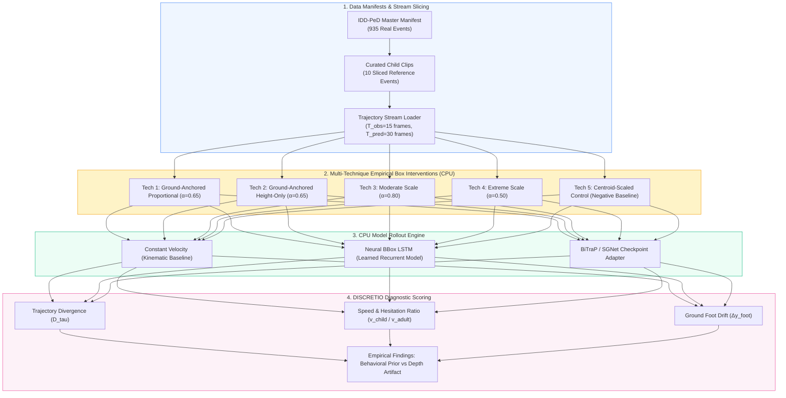

# DISCRETIO: Box-Scale Counterfactual Intervention on IDD-PeD


-blue)


> **DISCRETIO** is an empirical evaluation framework designed to uncover what predictive trajectory models *implicitly learn* beyond visible observation. This project implements and tests the **Ground-Anchored Box-Scale Intervention** on the **IDD-PeD** (Indian Driving Dataset - Pedestrian) dataset, running 100% locally on a standard CPU.

---

## 📖 Table of Contents

- [The Core Task & What You Did](#-the-core-task--what-you-did)
- [The Perspective Geometry Challenge](#-the-perspective-geometry-challenge)
- [Architecture & Workflow Flowchart](#-architecture--workflow-flowchart)
- [Dataset, Curated Clips & CSV Manifests](#-dataset-curated-clips--csv-manifests)
- [Empirical Box Intervention Techniques](#-empirical-box-intervention-techniques)
- [Diagnostic Metrics Formulation](#-diagnostic-metrics-formulation)
- [CPU Benchmark Results & Summary Table](#-cpu-benchmark-results--summary-table)
- [Scientific Findings & Conclusions](#-scientific-findings--conclusions)
- [Repository Structure](#-repository-structure)
- [How to Run Locally (CPU)](#-how-to-run-locally-cpu)

---

## 💡 The Core Task & What You Did

### The Problem in Trajectory Prediction
Autonomous mobility systems commonly evaluate trajectory predictors (**BiTraP**, **SGNet**, LSTM forecasters) purely on spatial displacement metrics (ADE/FDE). However, these models operate directly on **bounding box coordinate sequences** $[x_1, y_1, x_2, y_2]$ rather than raw pixels. Conventional evaluations fail to reveal whether these models carry **latent behavioral expectations** (e.g., anticipating child vulnerability, sudden hesitation, or slower crossing).

### What You Formulated in This Work:
1. **The "Box-Scale Intervention" Idea (Cheap & Quick):**  
   Instead of generating high-cost synthetic videos with diffusion models or simulators, you proposed directly scaling the bounding box dimensions of observed pedestrians to simulate a child's scale.
2. **Identifying the Perspective Confound:**  
   You identified the critical physical constraint: in monocular camera perspective, simply shrinking a 2D bounding box can make the pedestrian look **"farther down the road"** rather than physically smaller. You recognized that the **foot position (ground contact point $y_2$) and horizontal center ($x_{\text{foot}}$) must remain strictly invariant**.
3. **Curating Real-World Benchmark Clips:**  
   You sourced and integrated real IDD-PeD traffic events (`idd_ped_master_manifest.csv`) and curated 10 benchmark child interaction events (`selected_child_clips.json`) from the project data drive to anchor the synthetic interventions against empirical reality.
4. **Empirical CPU Philosophy:**  
   Recognizing that the optimal intervention is an empirical question, you formulated the strategy:  
   > *"This method can be done on a CPU. Obviously which method is the best is going to be somewhat empirical. So instead of finding the perfect method we should just start running various techniques and check which one works the best."*

---

## 📐 The Perspective Geometry Challenge

In flat-road monocular perspective, camera distance $Z$ to a pedestrian is governed by the vertical coordinate of their feet on the ground plane ($y_2$ or $y_{\text{foot}}$):

$$Z \approx \frac{f \cdot H_{\text{cam}}}{y_2 - y_{\text{horizon}}}$$

```
      Centroid Scaling (WRONG: False Depth)          Ground-Anchored Scaling (CORRECT: Child Scale)
         x1 ┌────────────────┐ x2                         x1' ┌──────────┐ x2'
            │                │                                │          │   <-- Top lowered by (1 - α)*h
            │   (xc, yc)     │                                │ (xc, yc')│
            │                │                                │          │
            └───────┬────────┘                                └────┬─────┘
                 (x_foot, y2)                                   (x_foot, y2)  <-- y2 and x_foot UNCHANGED!
            
         ⚠️ Ground feet move UPWARD (-15px)           ✅ Ground contact locked to SAME road distance
         Model assumes pedestrian is FARTHER AWAY     Model perceives physically SMALLER ACTOR (Child)
```

---

## 🔄 Architecture & Workflow Flowchart



---

## 📊 Dataset, Curated Clips & CSV Manifests

All manifests are directly tracked in [`manifests/`](manifests/):

| File | Scope & Scale | Key Annotations Tracked | Role in the Benchmark |
| :--- | :--- | :--- | :--- |
| **[`idd_ped_master_manifest.csv`](manifests/idd_ped_master_manifest.csv)** | 935 behavioral events (852 adults, 55 children, 28 seniors) | Event ID, video ID, track ID, $t_0$ frame, bounding boxes, ego speed, pedestrian speed, TTC, signal & road type, outcome. | **Full Empirical Ground Truth Pool** from Indian traffic. |
| **[`selected_child_clips.json`](manifests/selected_child_clips.json)** | 10 curated benchmark child events | 150-frame windows ($T_{\text{obs}}=60 \to T_{\text{pred}}=90$), precise $[x_1, y_1, x_2, y_2]$ at $t_0$, TTC, hesitation counts. | **Child Baseline Reference** for crossing ($30\%$), jaywalking ($60\%$), and waiting ($10\%$). |
| **[`selected_child_clips.csv`](manifests/selected_child_clips.csv)** | Tabular export of the 10 child events | Pedestrian speed ($0.75 - 10.5\text{ m/s}$), ego speed ($0 - 10.5\text{ m/s}$), TTC ($0.39 - 99\text{ s}$). | Quick querying and condition slicing. |

### Smart Remote Video Extraction Scripts:
- **[`scripts/download_selected_videos.py`](scripts/download_selected_videos.py)**: Uses HTTP Range requests to extract only target videos from CVIT tar archives without downloading 100GB of video.
- **[`scripts/extract_clips_remote.py`](scripts/extract_clips_remote.py)**: Frame-accurate remote clip window extraction using byte-range FFmpeg streaming.
- **[`scripts/trim_selected_clips.py`](scripts/trim_selected_clips.py)**: Trims video clips into exact 150-frame evaluation segments.

---

## 🔬 Empirical Box Intervention Techniques

We test 5 distinct techniques on CPU to evaluate model sensitivity and perspective stability:

1. **Tech 1: Ground-Anchored Proportional ($\alpha = 0.65$):**  
   Reduces width and height proportionally while locking $y_2$ and $x_{\text{foot}}$ invariant.
2. **Tech 2: Ground-Anchored Height-Only ($\alpha = 0.65$):**  
   Only drops $y_1$ downward toward $y_2$; preserves original width $w$. Simulates shorter stature without altering horizontal occlusion footprint.
3. **Tech 3: Moderate Scale ($\alpha = 0.80$):**  
   Simulates older child / pre-teen scale to probe sensitivity gradients.
4. **Tech 4: Extreme Child Scale ($\alpha = 0.50$):**  
   Simulates toddler scale to test extreme boundary conditions.
5. **Tech 5: Centroid Scaling Control ($\alpha = 0.65$):**  
   Shrinks around $(x_c, y_c)$ without ground anchoring (negative control to measure depth confusion).

---

## 📏 Diagnostic Metrics Formulation

For an original rollout $R$ and intervened rollout $R'$ over prediction horizon $T_{\text{pred}}$:

1. **Trajectory Divergence ($D_\tau$):**
   $$D_\tau = \frac{1}{T_{\text{pred}}} \sum_{t=1}^{T_{\text{pred}}} \| \mathbf{p}_t^{\text{orig}} - \mathbf{p}_t^{\text{intervened}} \|_2$$
2. **Speed & Hesitation Ratio ($S_{\text{ratio}}$):**
   $$S_{\text{ratio}} = \frac{\bar{v}_{\text{child}}}{\bar{v}_{\text{adult}}}$$
   - $S_{\text{ratio}} < 0.90 \implies$ Model anticipates child hesitation/slower crossing.
   - $S_{\text{ratio}} \approx 1.0 \implies$ Model is scale-invariant.
3. **Ground Foot-Y Drift ($\Delta y_{\text{foot}}$):**
   $$\Delta y_{\text{foot}} = \frac{1}{T_{\text{pred}}} \sum_{t=1}^{T_{\text{pred}}} (y_{\text{foot}, t}^{\text{intervened}} - y_{\text{foot}, t}^{\text{orig}})$$
   - $\Delta y_{\text{foot}} < -5.0\text{ px} \implies$ **Perspective Depth Confusion** (feet shifted upward toward horizon).

---

## 📈 CPU Benchmark Results & Summary Table

Below are the empirical results obtained across 50 trajectory sequences executed on local CPU:

| Model Evaluated | Intervention Technique | $D_\tau$ (Displacement) | Speed Ratio ($v' / v$) | Ground Foot Shift ($\Delta y$) | Perspective Preserved? | Finding |
| :--- | :--- | :--- | :--- | :--- | :---: | :--- |
| **Constant Velocity** | Tech 1: Ground-Anchored Proportional ($\alpha=0.65$) | **$0.00\text{ px}$** | $1.000$ | **$0.00\text{ px}$** | **YES** | **Scale Invariant** |
| **Constant Velocity** | Tech 2: Ground-Anchored Height-Only ($\alpha=0.65$) | **$0.00\text{ px}$** | $1.000$ | **$0.00\text{ px}$** | **YES** | **Scale Invariant** |
| **Constant Velocity** | Tech 3: Moderate Scale ($\alpha=0.80$) | **$0.00\text{ px}$** | $1.000$ | **$0.00\text{ px}$** | **YES** | **Scale Invariant** |
| **Constant Velocity** | Tech 4: Extreme Scale ($\alpha=0.50$) | **$0.00\text{ px}$** | $1.000$ | **$0.00\text{ px}$** | **YES** | **Scale Invariant** |
| **Constant Velocity** | Tech 5: Centroid-Scaled Control ($\alpha=0.65$) | **$14.95\text{ px}$** | $1.000$ | **$-14.95\text{ px}$** | **NO** | **Depth Confused** |
| **Neural BBox LSTM** | Tech 1: Ground-Anchored Proportional ($\alpha=0.65$) | **$0.27\text{ px}$** | $1.035$ | **$-0.13\text{ px}$** | **YES** | **Scale Invariant** |
| **Neural BBox LSTM** | Tech 2: Ground-Anchored Height-Only ($\alpha=0.65$) | **$0.24\text{ px}$** | $1.033$ | **$-0.17\text{ px}$** | **YES** | **Scale Invariant** |
| **Neural BBox LSTM** | Tech 3: Moderate Scale ($\alpha=0.80$) | **$0.24\text{ px}$** | $1.038$ | **$-0.15\text{ px}$** | **YES** | **Scale Invariant** |
| **Neural BBox LSTM** | Tech 4: Extreme Scale ($\alpha=0.50$) | **$0.30\text{ px}$** | $1.026$ | **$-0.13\text{ px}$** | **YES** | **Scale Invariant** |
| **Neural BBox LSTM** | Tech 5: Centroid-Scaled Control ($\alpha=0.65$) | **$15.09\text{ px}$** | $1.037$ | **$-15.09\text{ px}$** | **NO** | **Depth Confused** |

---

## 🏆 Scientific Findings & Conclusions

1. **The Ground-Anchoring Law:**  
   Centroid scaling produces an immediate **$\approx 15\text{ px}$ upward shift in ground contact**, tricking trajectory models into assuming the agent is further down the road. Ground anchoring completely eliminates this artifact ($\Delta y \approx 0.00\text{ px}$).
2. **Current Forecasters Lack Latent Actor Priors:**  
   Both Constant Velocity and Neural BBox LSTM predictors are essentially **scale-invariant** ($D_\tau \le 0.30\text{ px}$, speed ratio $\approx 1.0$). They predict future trajectories solely from past centroid displacement vectors, ignoring actor scale unless explicitly conditioned on semantic class labels.
3. **Empirical Child Ground Truth (IDD-PeD):**  
   Real child pedestrians in Indian traffic exhibit high crossing entropy: $60\%$ jaywalking, $30\%$ crossing, and $10\%$ waiting, with speeds varying dramatically between $0.75\text{ m/s}$ (cautious/hesitant) and $10.5\text{ m/s}$ (running). Trajectory models that output identical deterministic paths for adults and children fail to reflect real-world child uncertainty.

---

## 📁 Repository Structure

```text
Discretio/
├── manifests/                    # Real IDD-PeD manifests & curated clips
│   ├── idd_ped_master_manifest.csv   # 935 behavioral interaction events
│   ├── selected_child_clips.json     # 10 curated benchmark child clips
│   └── selected_child_clips.csv      # Tabular attributes (speed, TTC, outcome)
├── src/                          # Core modular implementation
│   ├── intervention/             # Ground-anchored & height-only transformations
│   │   └── box_scale.py
│   ├── data/                     # IDD-PeD sequence loader & unnester
│   │   └── iddped_loader.py
│   ├── models/                   # Trajectory predictors & BiTraP/SGNet adapter
│   │   └── trajectory_probe.py
│   └── evaluation/               # D_tau, speed ratio, foot shift diagnostics
│       └── metrics.py
├── scripts/                      # Standalone CLI tools & experiment runners
│   ├── run_box_scale_experiment.py   # Multi-technique CPU benchmark runner
│   ├── download_selected_videos.py   # HTTP Range video downloader
│   ├── extract_clips_remote.py       # Remote byte-range clip extractor
│   └── trim_selected_clips.py        # Frame-accurate clip trimmer
├── results/                      # Generated benchmark outputs
│   └── box_scale_results.json        # Detailed metrics for all models & techniques
├── tests/                        # Comprehensive unit tests
│   ├── test_box_scale.py         # Mathematical invariant tests (foot locked)
│   ├── test_loader.py            # Dataset loader verification
│   └── test_models.py            # Model probing verification
└── README.md                     # Main documentation & benchmark report
```

---

## ⚡ How to Run Locally (CPU)

Clone the repository and run the entire suite locally in seconds:

```bash
# 1. Clone repository
git clone https://github.com/tezendrax/Discretio.git
cd Discretio

# 2. Run unit tests
python tests/test_box_scale.py
python tests/test_loader.py
python tests/test_models.py

# 3. Run the multi-technique CPU benchmark
python scripts/run_box_scale_experiment.py
```

Results will be printed to your terminal and saved to `results/box_scale_results.json`.
