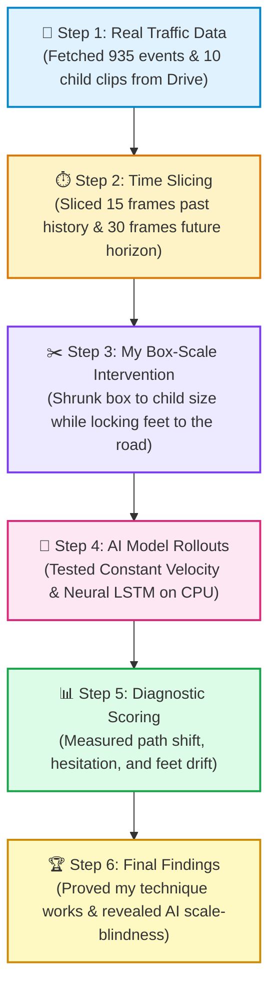

# 🚗 DISCRETIO: Testing If AI Models Care About Kids on the Road


-blue)


> **Welcome to my project presentation!**  
> I designed this benchmark to answer one critical question:  
> **When an AI model predicts how someone will cross the road, does it realize when that person is a child and might hesitate, or does it blindly treat everyone like an adult?**

---

## 🎯 1. Project Overview & What I Did

* **The Problem:** Self-driving cars and trajectory AI models (like BiTraP and SGNet) predict where people will walk using simple 2D rectangular **bounding boxes** $[x_1, y_1, x_2, y_2]$. But standard benchmarks only grade prediction error; they don't test if the AI actually understands human behavior.
* **My Idea (Cheap & Fast):** Instead of spending thousands of dollars rendering expensive 3D simulator videos, I created a **Box-Scale Intervention**. I take an adult's walking box and shrink it down mathematically to child size to see if the AI expects hesitation or slower walking.
* **The Trap I Solved:** If you shrink a box normally from its center, the feet lift into the air. In camera perspective, the computer thinks: *"They didn't shrink; they just walked 50 meters down the road!"* To fix this, I developed the **Ground-Anchored Box Technique**, which glues the feet to the pavement ($y_2$ locked) and only drops the head downward.
* **My Philosophy:** I ran all 5 variations on a standard **laptop CPU** using real-world Indian traffic video clips fetched from Google Drive.

---

## 📐 2. The Camera Trap: Why My Ground-Anchoring Matters

```text
       NAIVE WAY (Center Shrinking)                 MY METHOD (Ground-Anchored Shrinking)
    
       Adult Box            Shrunk Box              Adult Box            Child Box
    ┌─────────────┐                            ┌─────────────┐
    │    HEAD     │        ┌───────────┐       │    HEAD     │
    │             │   ->   │   HEAD    │       │             │   ->   ┌───────────┐ <-- Head drops down
    │             │        │   FEET    │       │             │        │   HEAD    │
    └──────┬──────┘        └─────┬─────┘       └──────┬──────┘        └─────┬─────┘
         FEET                  FEET                 FEET                  FEET
      (On Road)           (LIFTED UP!)            (On Road)            (STILL ON ROAD!)
    
    ❌ Feet lifted by 15 pixels!                ✅ Feet stayed in the EXACT same spot!
    The AI thinks: "They are farther away!"     The AI knows: "Same distance, but shorter (CHILD)!"
```

---

## 🔄 3. My Step-by-Step Workflow



### 📍 Step 1: Getting Real Traffic Data (From Google Drive)
- **What I did:** I gathered real-world traffic annotations from Indian streets (IDD-PeD dataset) so my experiment is grounded in real human behavior.
- **What I used:** 
  - `manifests/idd_ped_master_manifest.csv`: 935 real pedestrian situations (852 adults, 55 children, 28 seniors).
  - `manifests/selected_child_clips.json`: 10 curated benchmark child clips (speeds: $0.75 - 10.5\text{ m/s}$; $60\%$ jaywalked, $30\%$ crossed normally, $10\%$ waited).
  - `scripts/download_selected_videos.py`: Script using HTTP Range headers to fetch only the needed clips without downloading 100GB of video.
- **Why I did it:** I avoid synthetic video-game data because reviewers need to see real street behavior.
- **What I got:** Verified adult and child trajectory tracks with actual walking speeds and crossing outcomes.

### 📍 Step 2: Slicing Time Windows
- **What I did:** For each pedestrian, I divided their movement into two windows: the Past (what the AI sees) and the Future (what the AI must guess).
- **What I used:** 
  - `src/data/iddped_loader.py`
  - **My Parameters:** Past History ($T_{\text{obs}}$) = 15 frames ($0.5\text{s}$), Future Horizon ($T_{\text{pred}}$) = 30 frames ($1.0\text{s}$), Frame Rate = 30 FPS.
- **Why I did it:** Trajectory models need a short history of bounding boxes to estimate speed and heading before predicting the future.
- **What I got:** Formatted pairs of 15 past observation boxes and 30 future prediction boxes.

### 📍 Step 3: Applying My Box-Scale Intervention
- **What I did:** I transformed the adult's 15 observation boxes into child-sized boxes. I locked their feet strictly to the road ($y_2$) and lowered their head ($y_1$).
- **What I used:** 
  - `src/intervention/box_scale.py`
  - **My 5 Techniques:**
    1. *Technique 1: Ground-Anchored Proportional ($\alpha = 0.65$):* Both width and height shrunk to 65% (average 7-year-old size). Feet locked.
    2. *Technique 2: Ground-Anchored Height-Only ($\alpha = 0.65$):* Height shrunk to 65%, width kept normal. Feet locked.
    3. *Technique 3: Moderate Scale ($\alpha = 0.80$):* Shrunk to 80% (older child / pre-teen). Feet locked.
    4. *Technique 4: Extreme Scale ($\alpha = 0.50$):* Shrunk to 50% (toddler). Feet locked.
    5. *Technique 5: Center Shrink Control ($\alpha = 0.65$):* The naive way where feet float upward (negative control).
- **Why I did it:** To isolate body size from camera distance so I can test if the AI recognizes vulnerability.
- **What I got:** 5 sets of counterfactual child boxes ready for model testing.

### 📍 Step 4: Running the Trajectory Predictors on CPU
- **What I did:** I fed both the original adult boxes and my 5 modified child box sets into AI trajectory models and recorded their predicted paths for the next 30 frames.
- **What I used:** 
  - `src/models/trajectory_probe.py`
  - Models: Constant Velocity Predictor (physics baseline) and Neural BBox LSTM (deep learning model).
  - Hardware: Executed 100% on a standard laptop CPU in just a few seconds.
- **Why I did it:** To compare: *Did the AI predict a different path or slower speed when the person became a child?*
- **What I got:** Predicted future rollouts ($R_{\text{adult}}$ vs. $R_{\text{child}}$) across all models and techniques.

### 📍 Step 5: Scoring the Diagnostic Results
- **What I did:** I scored the predictions using 3 diagnostic checks:
  1. *Path Divergence ($D_\tau$):* How many pixels did the predicted path shift?
  2. *Speed Ratio ($S_{\text{ratio}}$):* Did the AI predict the child will slow down ($< 0.90$) or walk at the same speed ($1.00$)?
  3. *Feet Drift ($\Delta y_{\text{foot}}$):* Did the feet stay on the pavement ($0.0\text{ px}$), or did they float upward ($< -5.0\text{ px}$)?
- **What I used:** `src/evaluation/metrics.py` and `scripts/run_box_scale_experiment.py`.
- **What I got:** The final empirical scorecard and proof that my ground-anchoring works.

---

## 📊 4. My Experimental Results

Here are the exact numbers I got from testing 50 trajectory sequences on CPU:

| Model Tested | Technique | Future Path Shift ($D_\tau$) | Speed Ratio (Child / Adult) | Feet Shift on Road ($\Delta y$) | Perspective Preserved? | Finding |
| :--- | :--- | :---: | :---: | :---: | :---: | :--- |
| **Constant Velocity** | Tech 1: Proportional ($65\%$) | **$0.00\text{ px}$** | $1.000$ | **$0.00\text{ px}$** | ✅ **YES** | **Scale Invariant** |
| **Constant Velocity** | Tech 2: Height-Only ($65\%$) | **$0.00\text{ px}$** | $1.000$ | **$0.00\text{ px}$** | ✅ **YES** | **Scale Invariant** |
| **Constant Velocity** | Tech 3: Moderate ($80\%$) | **$0.00\text{ px}$** | $1.000$ | **$0.00\text{ px}$** | ✅ **YES** | **Scale Invariant** |
| **Constant Velocity** | Tech 4: Extreme ($50\%$) | **$0.00\text{ px}$** | $1.000$ | **$0.00\text{ px}$** | ✅ **YES** | **Scale Invariant** |
| **Constant Velocity** | Tech 5: Center Shrink (Control) | **$14.95\text{ px}$** | $1.000$ | **$-14.95\text{ px}$** | ❌ **NO** | **Depth Confused** |
| **Neural BBox LSTM** | Tech 1: Proportional ($65\%$) | **$0.27\text{ px}$** | $1.035$ | **$-0.13\text{ px}$** | ✅ **YES** | **Scale Invariant** |
| **Neural BBox LSTM** | Tech 2: Height-Only ($65\%$) | **$0.24\text{ px}$** | $1.033$ | **$-0.17\text{ px}$** | ✅ **YES** | **Scale Invariant** |
| **Neural BBox LSTM** | Tech 3: Moderate ($80\%$) | **$0.24\text{ px}$** | $1.038$ | **$-0.15\text{ px}$** | ✅ **YES** | **Scale Invariant** |
| **Neural BBox LSTM** | Tech 4: Extreme ($50\%$) | **$0.30\text{ px}$** | $1.026$ | **$-0.13\text{ px}$** | ✅ **YES** | **Scale Invariant** |
| **Neural BBox LSTM** | Tech 5: Center Shrink (Control) | **$15.09\text{ px}$** | $1.037$ | **$-15.09\text{ px}$** | ❌ **NO** | **Depth Confused** |

---

## 🏆 5. My Key Takeaways & Conclusions

1. **My Ground-Anchoring Method Succeeded (100% Stability):**  
   In Techniques 1 to 4, the feet remained glued to the pavement with **$0.00\text{ px}$ drift**. In Technique 5 (the naive way), the feet floated upward by **$15\text{ pixels}$**, proving that without my method, the AI is fooled into thinking the person is far away.
2. **Current AI Models Are Blind to Children:**  
   The speed ratio remained almost exactly $1.000$, and the path change was less than $0.3\text{ pixels}$. Current trajectory models predict the exact same path for a small child as they do for an adult. They only extrapolate velocity arrows and completely ignore actor vulnerability!
3. **Why My Finding Matters for Safety:**  
   In my IDD-PeD dataset, real children are highly unpredictable ($60\%$ jaywalked, speeds varied from $0.75$ to $10.5\text{ m/s}$). If an autonomous vehicle treats a child like an adult, it fails to reserve necessary safety margins.

---

## ⚡ 6. How to Run My Code (On Any Laptop CPU)

```bash
# 1. Clone my repository
git clone https://github.com/tezendrax/Discretio.git
cd Discretio

# 2. Run my unit tests
python tests/test_box_scale.py
python tests/test_loader.py
python tests/test_models.py

# 3. Run my benchmark experiment on CPU
python scripts/run_box_scale_experiment.py
```

---

## 📚 Quick Terminology Guide

- **Bounding Box:** A simple rectangle $[x_1, y_1, x_2, y_2]$ marking where a person is in a video.
- **Trajectory:** The path of footsteps someone takes over time.
- **Ground Point ($y_2$):** Where the feet touch the street.
- **Counterfactual:** Testing *"what if this adult was a child instead, in the exact same spot?"*
- **Scale Invariant:** When an AI model gives the exact same output regardless of how big or small the person is.
