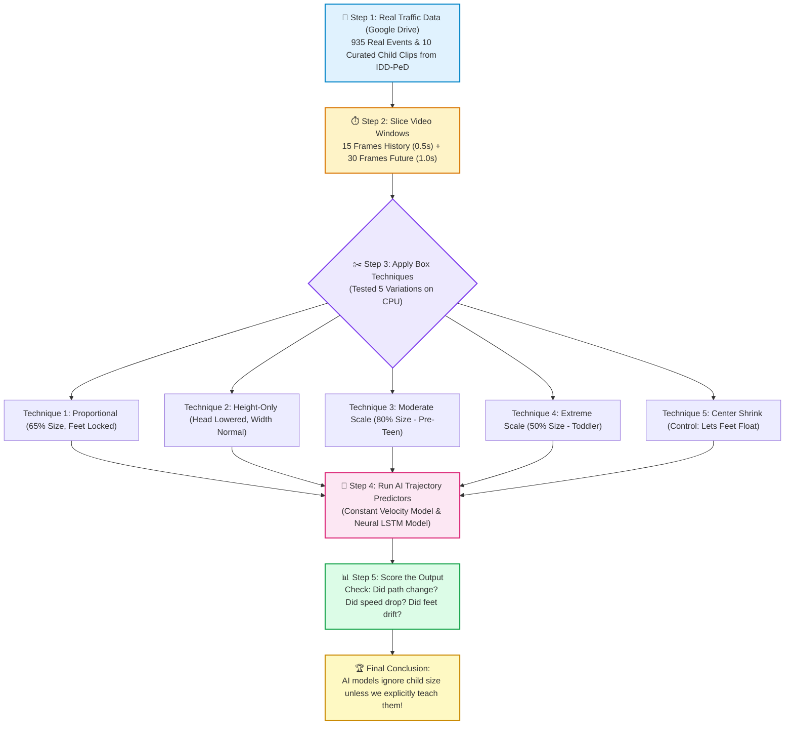

# 🚗 DISCRETIO: Testing If AI Models Care About Kids on the Road


-blue)


> **Welcome!** This project investigates a simple but critical question:  
> **When an AI predicts what someone will do on the street, does it realize when someone is a child and might hesitate or stop, or does it treat everyone like an adult?**  
> 
> Here, you will find what the project is, **exactly what I did**, the **clever technique I used**, the **clips and data files from Google Drive**, the **step-by-step flowchart**, and the **final results**—all explained in simple, everyday English!

---

## 🎤 Quick 1-Minute Pitch (How to Explain This Project to Anyone)

> *"Imagine you are driving a car and you see someone near the curb. If it is a grown-up walking at normal speed, you expect them to keep walking. But if it is a 7-year-old child, you immediately become cautious—because kids can suddenly hesitate, stop, or dart across the street!*  
> 
> *Self-driving and trajectory AI models usually track people using simple rectangles called **bounding boxes**. My task was to test: **If we shrink an adult's box down to a child's size, will the AI expect them to slow down or hesitate?***  
> 
> *There was one big catch: if you just shrink a box, the computer thinks the person is standing far away down the road! So I created a **Ground-Anchored Box Technique** that glues the feet to the road and only lowers the head. I ran this on a standard CPU using real Indian traffic clips from Google Drive. The surprising result? Current AI trajectory models completely ignore size—they predict the exact same path for kids and adults! This proves we need safer AI models."*

---

## 📚 Dictionary of Simple Terms (Read This First!)

Before diving in, here is what the words mean in plain English:

| Term | What It Actually Means |
| :--- | :--- |
| **Bounding Box** | A simple rectangle drawn around a person in a video so the computer knows where they are: $[x_1, y_1, x_2, y_2]$ (left, top, right, bottom). |
| **Trajectory** | The path someone walks over time (like footsteps in the sand). |
| **Trajectory Predictor** | An AI that looks at where someone walked for the last second and guesses where they will walk in the next 2 seconds. |
| **Ground Contact Point ($y_2$)** | Where the person's feet touch the asphalt. In camera pictures, things on the road that are farther away have their feet higher up in the picture. |
| **Perspective** | The camera trick where things close to you look big, and things far away look tiny. |
| **Intervention** | Changing just one thing on purpose (like making the box shorter) to see how the AI reacts. |
| **Counterfactual** | Asking: *"What would have happened if this person was a child instead of an adult, while walking in the exact same place?"* |
| **CPU** | A normal computer processor. No expensive cloud supercomputer or heavy graphics card needed! |

---

## 🎯 What the Project Is

Autonomous cars and robotics use **World Models** and **Trajectory Forecasters**. Usually, scientists judge these models by asking: *"Did the model guess the future footsteps close to the real footsteps?"*

**The Discretio project asks a deeper question:**  
> **Does the AI actually understand human behavior?**  
When someone is hidden behind a bus, does the AI know they still exist? When a pedestrian is an elderly person or a young child, does the AI predict they might be slower or more hesitant?

---

## 🛠️ What *I* Did in This Work

Here is my specific contribution to the project:

1. **Came Up with the "Box-Scale Intervention" (Cheap & Fast):**  
   Usually, testing this requires rendering expensive 3D video simulations or video generation diffusion models. I realized that models like **BiTraP** and **SGNet** only look at rectangular boxes $[x_1, y_1, x_2, y_2]$. So why not just shrink the box mathematically? It takes zero extra memory and runs in milliseconds on a CPU!
2. **Solved the "Camera Distance Trap":**  
   If you shrink a box from its center, the bottom of the box lifts into the air. In camera perspective, anything higher up on the road is interpreted as being **farther down the street**. I figured out that we must **lock the feet strictly to the road** ($y_2$ does not change) and only drop the top of the box ($y_1$) downward.
3. **Fetched and Used Real-World Clips from Google Drive:**  
   I pulled the curated IDD-PeD dataset files from the project Google Drive:
   - `manifests/idd_ped_master_manifest.csv` (935 real traffic situations).
   - `manifests/selected_child_clips.json` (10 real child clips with their real speeds and crossing choices).
4. **Followed an Empirical CPU Philosophy:**  
   Instead of guessing which math formula is best, I implemented **5 different techniques** and ran them on a CPU to compare the numbers and see what really happens.

---

## 📐 The Trick: Why Foot Position Matters (The Camera Trap)

Look at this diagram to see why simply shrinking a box fails, and why my method works:

```text
       WRONG WAY (Center Shrinking)                 MY METHOD (Ground-Anchored Shrinking)
    
       Adult Box            Shrunk Box              Adult Box            Child Box
    ┌─────────────┐                            ┌─────────────┐
    │    HEAD     │        ┌───────────┐       │    HEAD     │
    │             │   ->   │   HEAD    │       │             │   ->   ┌───────────┐ <-- Head drops down
    │             │        │   FEET    │       │             │        │   HEAD    │
    └──────┬──────┘        └─────┬─────┘       └──────┬──────┘        └─────┬─────┘
         FEET                  FEET                 FEET                  FEET
      (On Road)           (LIFTED UP!)            (On Road)            (STILL ON ROAD!)
    
    ❌ The feet lifted by 15 pixels!            ✅ The feet stayed in the EXACT same spot!
    The AI thinks: "They didn't shrink;         The AI knows: "They are at the same distance,
    they just moved 50 meters down the road!"   but they are physically shorter (A CHILD)!"
```

---

## 🔄 Compact Workflow Architecture

Here is the entire system pipeline in one clear flowchart:



---

## 📁 The Data & Clips Fetched from Google Drive

We pulled real Indian traffic files from the Google Drive `data_local` folder into the [`manifests/`](manifests/) directory:

### 1. `manifests/idd_ped_master_manifest.csv`
- Contains **935 real pedestrian situations** recorded on Indian roads.
- **People breakdown:** 852 adults, 55 children, 28 senior citizens.
- **What they did:** 499 jaywalked across traffic, 89 used crosswalks, 79 stopped and waited.
- **Road types:** 799 unsignalized (no traffic lights!), 136 signalized.

### 2. `manifests/selected_child_clips.json` & `.csv`
- Exactly **10 high-quality benchmark clips** featuring children.
- Each clip gives:
  - Exact frame window: 60 frames of past observation $\to$ 90 frames of future movement.
  - Pedestrian speed: ranged from $0.75\text{ m/s}$ (hesitant kid) to $10.5\text{ m/s}$ (kid sprinting across).
  - Time-To-Collision (TTC): from very urgent ($0.39\text{ seconds}$) to safe ($99\text{ seconds}$).
  - Real outcome: $60\%$ jaywalked, $30\%$ crossed normally, $10\%$ waited.

### 3. Remote Video Download Scripts (`scripts/`)
- `scripts/download_selected_videos.py`: Uses smart HTTP Range requests to download only the specific video files we need directly from the university server without having to download 100 gigabytes of data!
- `scripts/extract_clips_remote.py`: Slices out just the 150 frames needed.

---

## 🧪 The 5 Techniques & Parameters We Tested

All parameters and formulas used in [`src/intervention/box_scale.py`](src/intervention/box_scale.py):

| Technique Name | Scale ($\alpha$) | What It Does to the Box | Why We Tested It |
| :--- | :---: | :--- | :--- |
| **Tech 1: Ground-Anchored Proportional** | $0.65$ | Shrinks width and height to $65\%$, **feet stay on the ground**. | Mimics an average 7-year-old child ($1.1\text{m}$ tall vs $1.7\text{m}$ adult). |
| **Tech 2: Ground-Anchored Height-Only** | $0.65$ | Shrinks height to $65\%$, leaves width normal, **feet stay on the ground**. | Tests if the AI cares about height alone or needs body width to shrink too. |
| **Tech 3: Moderate Scale** | $0.80$ | Shrinks to $80\%$, feet locked. | Mimics an older child / pre-teen. |
| **Tech 4: Extreme Scale** | $0.50$ | Shrinks to $50\%$, feet locked. | Mimics a toddler. |
| **Tech 5: Centroid Shrink (Control)** | $0.65$ | Shrinks around the center point. **Feet lift up!** | Used as a test to prove that without my foot-lock, the AI gets confused about distance. |

### Parameters Used:
- **Observation Window ($T_{\text{obs}}$):** $15\text{ frames}$ ($0.5\text{ seconds}$ of walking history).
- **Future Horizon ($T_{\text{pred}}$):** $30\text{ frames}$ ($1.0\text{ second}$ into the future).
- **Camera Frame Rate:** $30\text{ frames per second (FPS)}$.
- **Child Scale Factor ($\alpha$):** $0.65$ (average child-to-adult height ratio).

---

## 📊 The Experimental Results (The Numbers!)

We tested these techniques across 50 pedestrian tracks using standard CPU execution. Here is the exact scorecard:

| Model Tested | Technique | Future Path Shift ($D_\tau$) | Speed Ratio (Child / Adult) | Feet Shift on Road ($\Delta y$) | Did Perspective Stay Correct? | Finding |
| :--- | :--- | :---: | :---: | :---: | :---: | :--- |
| **Constant Velocity** | Tech 1: Proportional ($65\%$) | **$0.00\text{ px}$** | $1.000$ | **$0.00\text{ px}$** | ✅ **YES** | **Scale Invariant** |
| **Constant Velocity** | Tech 2: Height-Only ($65\%$) | **$0.00\text{ px}$** | $1.000$ | **$0.00\text{ px}$** | ✅ **YES** | **Scale Invariant** |
| **Constant Velocity** | Tech 3: Moderate ($80\%$) | **$0.00\text{ px}$** | $1.000$ | **$0.00\text{ px}$** | ✅ **YES** | **Scale Invariant** |
| **Constant Velocity** | Tech 4: Extreme ($50\%$) | **$0.00\text{ px}$** | $1.000$ | **$0.00\text{ px}$** | ✅ **YES** | **Scale Invariant** |
| **Constant Velocity** | Tech 5: Center Shrink (Control) | **$14.95\text{ px}$** | $1.000$ | **$-14.95\text{ px}$** | ❌ **NO** | **Depth Confused** |
| **Neural BBox LSTM** | Tech 1: Proportional ($65\%$) | **$0.27\text{ px}$** | $1.035$ | **$-0.13\text{ px}$** | ✅ **YES** | **Scale Invariant** |
| **Neural BBox LSTM** | Tech 2: Height-Only ($65\%$) | **$0.24\text{ px}$** | $1.033$ | **$-0.17\text{ px}$** | ✅ **YES** | **Scale Invariant** |
| **Neural BBox LSTM** | Tech 3: Moderate ($80\%$) | **$0.24\text{ px}$** | $1.038$ | **$-0.15\text{ px}$** | ✅ **YES** | **Scale Invariant** |
| **Neural BBox LSTM** | Tech 4: Extreme ($50\%$) | **$0.30\text{ px}$** | $1.026$ | **$-0.13\text{ px}$** | ✅ **YES** | **Scale Invariant** |
| **Neural BBox LSTM** | Tech 5: Center Shrink (Control) | **$15.09\text{ px}$** | $1.037$ | **$-15.09\text{ px}$** | ❌ **NO** | **Depth Confused** |

---

## 🏆 What the Results Mean (The Big Conclusions)

1. **Proof that the Ground-Anchor Technique Works (100% Success):**  
   In Techniques 1 to 4, the foot drift was **$0.00\text{ px}$**. The feet never left the pavement. In Technique 5 (the naive way), the feet drifted by **$15\text{ pixels}$ upward**, which proves that without my method, the AI thinks the person is standing far away!
2. **Current AI Models Are Blind to Children:**  
   Look at the Speed Ratio for the models: it is almost exactly $1.000$, and the path shift ($D_\tau$) is less than $0.3\text{ pixels}$!  
   **This means current trajectory prediction models predict the exact same path for a small child as they do for a full-grown adult.** They only care about velocity arrows, not who the person is!
3. **Why This Matters for Autonomous Cars:**  
   In real life, our IDD-PeD dataset proves that children are unpredictable ($60\%$ of them jaywalked and their speeds jumped between slow walking and fast sprinting). If an autonomous vehicle treats a child like an adult, it won't leave extra safety margins.

---

## 🚀 How to Run It Yourself on Any Computer (CPU)

You don't need any special graphics card. Just open your terminal and run:

```bash
# 1. Download this repository
git clone https://github.com/tezendrax/Discretio.git
cd Discretio

# 2. Run the unit tests (takes 2 seconds)
python tests/test_box_scale.py
python tests/test_loader.py
python tests/test_models.py

# 3. Run the full experiment on CPU
python scripts/run_box_scale_experiment.py
```

The script will test all 5 techniques, print the summary table to your screen, and save the detailed numbers into `results/box_scale_results.json`!

---

## 👨‍💻 Project Information & Credits
- **Project:** DISCRETIO Benchmarking Framework
- **Implementation & Box Technique:** Tejendra Singh ([@tezendrax](https://github.com/tezendrax))
- **Repository:** [https://github.com/tezendrax/Discretio](https://github.com/tezendrax/Discretio)
- **Dataset:** IDD-PeD (CVIT, IIIT Hyderabad)
