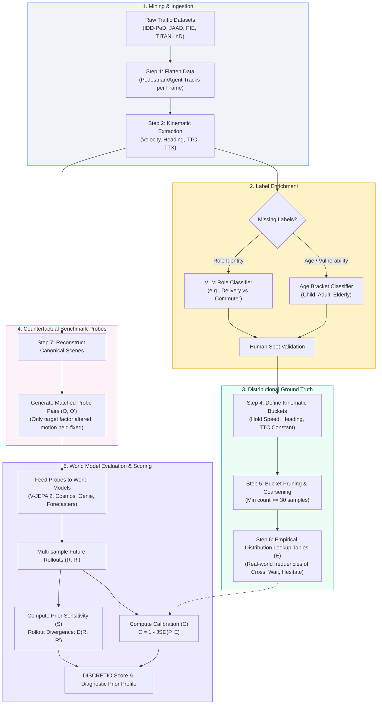

# DISCRETIO: Revealing Latent Behavioral Priors in Predictive World Models

[](https://colab.research.google.com/github/tezendrax/Discretio/blob/main/IDD_PeD_Box_Scale_Intervention.ipynb)

> **DISCRETIO** is an empirical benchmark and diagnostic evaluation framework designed to uncover what predictive world models *implicitly learn* beyond visible observation. By probing future rollouts under controlled counterfactual interventions, DISCRETIO audits the hidden physical, behavioral, social, and contextual assumptions that shape imagined futures.

---

## 📖 Table of Contents

- [Overview & Motivation](#-overview--motivation)
- [Core Concept: Latent Behavioral Priors](#-core-concept-latent-behavioral-priors)
- [The 4 Prior Families](#-the-4-prior-families)
- [End-to-End Workflow & Pipeline Architecture](#-end-to-end-workflow--pipeline-architecture)
- [Datasets & Ingestion Strategy](#-datasets--ingestion-strategy)
- [Metrics & Evaluation Mathematical Formulation](#-metrics--evaluation-mathematical-formulation)
- [Evaluated World Models](#-evaluated-world-models)
- [Repository Structure](#-repository-structure)
- [Implementation Roadmap](#-implementation-roadmap)
- [Getting Started & Installation](#-getting-started--installation)
- [Citation & References](#-citation--references)

---

## 🌟 Overview & Motivation

World models (video generation models, latent predictive architectures, and trajectory forecasters) are rapidly becoming the predictive substrate of embodied AI and autonomous agents. Traditional benchmarks evaluate these systems on **prediction quality** alone:
- Average Displacement Error (ADE) & Final Displacement Error (FDE)
- Pixel reconstruction loss / PSNR / SSIM / FID
- Downstream planning reward

### The Core Problem: Prediction $\neq$ Understanding
A model can produce visually plausible or low-loss future predictions while relying on fragile, biased, or ungrounded hidden assumptions:
- When a cyclist passes behind a bus, does the model maintain future occupancy (object permanence), or does the entity vanish?
- When a child approaches a crossing at the exact same velocity as an adult, does the model anticipate greater hesitation or wider safety margins?
- When a food delivery rider approaches a narrow bottleneck, does the model anticipate aggressive negotiation compared to a commuter?

**DISCRETIO** shifts world-model evaluation from **prediction accuracy** to **prior discovery**:
1. **Prior Sensitivity ($S$):** Does the model systematically alter its predicted futures when a hidden factor is manipulated?
2. **Prior Calibration ($C$):** Is that rollout shift justified by real-world human behavior distributions?

---

## 🧠 Core Concept: Latent Behavioral Priors

A **Latent Behavioral Prior** is a learned expectation that systematically shapes future rollouts when multiple futures remain compatible with the available observation.

Rather than assuming these priors are symbolic or hand-coded, DISCRETIO measures them directly from observable rollout signals:
- **Occupancy Persistence ($D_o$):** Entity presence in occluded zones.
- **Trajectory Divergence ($D_\tau$):** Deviations in path, speed, and heading.
- **Timing & Hesitation ($D_t$):** Crossing delays, deceleration profiles, and stopping probabilities.
- **Interaction Norms ($D_i$):** Yielding precedence, gap acceptance, and collision margins.
- **Uncertainty Dispersion ($D_u$):** Multi-modal rollout spread and entropy.

---

## 🎯 The 4 Prior Families

| Prior Family | Latent Priors Probed | Controlled Manipulation | Observable Rollout Signals |
| :--- | :--- | :--- | :--- |
| **1. Physical** | • Object permanence<br>• Hidden-state tracking<br>• Motion continuity | Occlusion duration & visibility gaps (holding trajectory and heading constant) | Occupancy persistence in occluded regions; plausible re-emergence trajectories. |
| **2. Behavioral** | • Intent inference<br>• Hesitation expectation<br>• Risk sensitivity | Actor identity (Adult vs. Child vs. Elderly, holding kinematics constant) | Timing shifts, multimodal crossing vs. waiting probabilities, safety margins. |
| **3. Social** | • Role expectations<br>• Yielding norms<br>• Bottleneck negotiation | Role substitution (Delivery rider vs. Commuter vs. Taxi vs. Vendor) | Priority shifts, acceleration, gap acceptance, yielding timing in shared spaces. |
| **4. Contextual** | • Cultural priors<br>• Environmental density<br>• Scene semantics | Environment substitution (Structured crosswalk vs. Unmarked road vs. Dense market) | Divergence in crossing confidence, jaywalking expectations, speed adaptation. |

---

## 🔄 End-to-End Workflow & Pipeline Architecture

The DISCRETIO workflow transforms raw driving and pedestrian videos into controlled counterfactual benchmark probes, calculates empirical ground truth, and scores world model rollouts.



### Detailed Pipeline Steps:
1. **Flattening Data:** Convert source datasets into unified tabular representations (frame-level bounding boxes, occlusion tags, ego-motion, GPS, and interaction flags).
2. **Adding Movement Features:** Compute continuous physical kinematics: instantaneous speed, heading, distance-to-curb, and Time-to-Collision (TTC).
3. **Filling Missing Labels:**
   - **Role Identification:** Use off-the-shelf Vision-Language Models (VLMs) on vehicle and rider crops from IDD-PeD, verified with human quality audits.
   - **Age Brackets:** Pretrained demographic classifiers for unannotated single pedestrians.
4. **Bucket Definition:** Group situations with identical physical and kinematic conditions into discrete conditioning buckets.
5. **Handling Sparse Buckets:** Require at least 30 real-world observations per bucket. If sparse, merge along fine movement bins while strictly preserving prior split axes (Age, Role, Context).
6. **Distributional Ground Truth ($E$):** Construct empirical probability tables of observed outcomes. *Strict rule: Ground truth is never generated with a simulator or video model.*
7. **Counterfactual Probes ($O, O'$):** Build video probes where the target variable changes while trajectory kinematics, camera perspective, and scene topology remain fixed.
8. **Rollout Scoring:** Roll forward models to generate multi-sample predictions $P$, computing sensitivity and calibration against ground truth $E$.

---

## 📊 Datasets & Ingestion Strategy

To ensure scientific validity, DISCRETIO preserves a strict distinction between **unstructured** and **structured** traffic cultures.

| Dataset | Origin & Scale | Annotation Highlights | Role in DISCRETIO |
| :--- | :--- | :--- | :--- |
| **[IDD-PeD](file:///Doc/DISCRETIO%20Dataset%20and%20Pipeline%20Plan.pdf#L28)** | India (IIIT Hyderabad, 2025)<br>205k frames, 5k pedestrians | Unstructured traffic, unsignalized junctions, jaywalking, occlusion, hand gestures, ego-telemetry. | **Primary Unstructured Source** for Indian behavioral, physical, and contextual statistics. |
| **[JAAD](file:///Doc/DISCRETIO%20Dataset%20and%20Pipeline%20Plan.pdf#L48)** | North America / Europe<br>346 clips, 240 hours | Age, gender, crossing behavior, crosswalk tags, occlusion flags. | **Age-Conditioned Priors** in structured settings. |
| **[PIE](file:///Doc/DISCRETIO%20Dataset%20and%20Pipeline%20Plan.pdf#L55)** | Toronto, Canada<br>293k frames, 1.8k pedestrians | Continuous footage, crossing intention annotations, ego-motion. | **Clean Base Rates** for crossing behavior without curation bias. |
| **[TITAN](file:///Doc/DISCRETIO%20Dataset%20and%20Pipeline%20Plan.pdf#L61)** | Tokyo, Japan<br>700 clips, 50 labels | Layered actions (simple, contextual, communicative), age groups. | **Social & Communicative Norms** in structured Asian traffic. |
| **[inD / rounD](file:///Doc/DISCRETIO%20Dataset%20and%20Pipeline%20Plan.pdf#L71)** | Germany (RWTH Aachen)<br>Drone trajectory recordings | Millimeter-accurate tracks across roundabouts and intersections. | **Physical Persistence & Multi-agent Negotiation** geometry. |

> [!IMPORTANT]
> **Data Pooling Rule:** Combining JAAD, PIE, and TITAN into a structured baseline pool is permissible when sample size demands it. **IDD-PeD must never be pooled with Western/structured datasets**, as comparing structured vs. unstructured behavior is the primary object of measurement.

---

## 📐 Metrics & Evaluation Mathematical Formulation

Each world model is evaluated on two orthogonal axes: **Sensitivity** and **Calibration**.

### 1. Prior Sensitivity ($S$)
Measures the magnitude of rollout divergence between original probe $O$ and counterfactual $O'$:
$$D(R, R') = \lambda_\tau D_\tau + \lambda_o D_o + \lambda_u D_u + \lambda_i D_i + \lambda_t D_t$$

Where:
- $D_\tau$: Trajectory displacement divergence
- $D_o$: Occupancy map divergence in occluded regions
- $D_u$: Uncertainty dispersion divergence (entropy / variance)
- $D_i$: Multi-agent interaction & distance margins
- $D_t$: Timing, hesitation, and deceleration profiles

Individual metric components are normalized to $[0, 1]$ relative to validation maximums:
$$\tilde{m} = \text{clip}\left(\frac{m}{m_{\max}}, 0, 1\right)$$

### 2. Prior Calibration ($C$)
Measures whether the model's rollout distribution $P$ aligns with real-world empirical outcome frequencies $E$:
$$C = 1 - \text{JSD}(P, E)$$

Where $\text{JSD}$ is the symmetric, bounded Jensen–Shannon Divergence:
$$\text{JSD}(P, E) = \frac{1}{2} D_{\text{KL}}(P \parallel M) + \frac{1}{2} D_{\text{KL}}(E \parallel M), \quad M = \frac{1}{2}(P + E)$$

### 3. Aggregate DISCRETIO Score
For each prior family $f \in \{\text{Physical (P)}, \text{Behavioral (B)}, \text{Social (S)}, \text{Contextual (CT)}\}$, we calculate sensitivity ($\text{FS}$) and calibration ($\text{FC}$):

$$\text{DISCRETIO}(M) = \frac{\text{PPS} + \text{BPS} + \text{SPS} + \text{CTS} + \text{PPC} + \text{BPC} + \text{SPC} + \text{CTC}}{8}$$

---

## 🤖 Evaluated World Models

The benchmark evaluates diverse predictive paradigms on identical probe sets:
- **Predictive Representation Models:** e.g., **V-JEPA 2** (latent joint-embedding architectures).
- **Generative Video World Models:** e.g., **Cosmos** (diffusion-based generative foundation models).
- **Interactive World Models:** e.g., **Genie** (action-controllable latent dynamics).
- **Trajectory Forecasting Baselines:** Kinematic and attention-based agent trajectory predictors.

---

## 📁 Repository Structure

```text
Discretio/
├── .vscode/                     # Editor and workspace settings
├── Doc/                         # Theoretical specifications & research papers
│   ├── DISCRETIO Dataset and Pipeline Plan.pdf
│   └── DOC-20260814-WA0001 (1).pdf
├── configs/                     # Experiment, bucketing, and model configs
│   ├── bucketing.yaml           # Bin definitions (speed, TTC, angles)
│   └── models.yaml              # Model rollout budgets and hyperparameters
├── data/                        # Dataset directories and ingestion scripts
│   ├── raw/                     # Raw datasets (IDD-PeD, JAAD, PIE, TITAN)
│   ├── processed/               # Flattened parquet/csv tables
│   └── ground_truth/            # Empirical outcome lookup tables (E)
├── probes/                      # Counterfactual scenario generation
│   ├── physical/                # Occlusion & blind-turn probes
│   ├── behavioral/              # Age & vulnerability probes
│   ├── social/                  # Role identity & yielding probes
│   └── contextual/              # Road topology & cultural transfer probes
├── src/                         # Core implementation source code
│   ├── ingestion/               # Parsers for IDD-PeD, JAAD, PIE, TITAN
│   ├── features/                # Kinematic calculators (speed, heading, TTC)
│   ├── annotators/              # VLM role classification & age tagging
│   ├── ground_truth/            # Bucketing & empirical frequency estimators
│   ├── models/                  # World model wrappers (V-JEPA 2, Cosmos, Genie)
│   └── evaluation/              # JSD, rollout divergence, and scoring engine
├── tests/                       # Unit and integration tests
├── scripts/                     # Execution and benchmark scripts
│   ├── run_ground_truth.py      # Build empirical lookup tables
│   ├── generate_probes.py       # Render counterfactual probe pairs
│   └── evaluate_model.py        # Run evaluation and output DISCRETIO report
├── environment.yml              # Conda environment definition
├── requirements.txt             # Pip dependencies
└── README.md                    # Project documentation & workflow guide
```

---

## 🗓️ Implementation Roadmap

```
┌─────────────────────────────────────────────────────────────────────────────┐
│                             Staged Execution Plan                           │
└─────────────────────────────────────────────────────────────────────────────┘
  Phase 1: Behavioral Prior Pipeline (Immediate Milestone)
  ├── 1.1 Ingest IDD-PeD, JAAD, and PIE pedestrian tracks
  ├── 1.2 Calculate speed, heading, and TTC
  ├── 1.3 Formulate age-conditioned crossing buckets (Child / Adult / Elderly)
  └── 1.4 Generate empirical crossing distributions & calibration pipeline

  Phase 2: Physical & Occlusion Probes
  ├── 2.1 Extract occlusion events from IDD-PeD and drone data
  ├── 2.2 Construct occlusion duration probes (holding velocity constant)
  └── 2.3 Implement future occupancy persistence metric (Do)

  Phase 3: Social Role Prior Pipeline
  ├── 3.1 Extract vehicle and rider crops from IDD-PeD
  ├── 3.2 Run VLM role classifier (Delivery rider vs Commuter) with spot-checks
  └── 3.3 Construct bottleneck negotiation probes

  Phase 4: Contextual Probes & Cultural Transfer
  ├── 4.1 Match identical maneuvers between IDD-PeD and JAAD/PIE
  └── 4.2 Benchmark cross-environment rollout shifts

  Phase 5: Full Benchmark Assembly & World Model Auditing
  ├── 5.1 Run baseline models (V-JEPA 2, Cosmos, Genie, Forecasters)
  └── 5.2 Produce DISCRETIO diagnostic scorecards and bias audit report
```

---

## 🚀 Getting Started & Installation

### Prerequisites
- Python 3.10+ (Python 3.13 supported)
- NVIDIA GPU with CUDA support (for model inference and VLM labeling)

### Setup
```bash
# Clone the repository
git clone https://github.com/your-org/Discretio.git
cd Discretio

# Create a virtual environment
python -m venv venv
# Windows:
.\venv\Scripts\activate
# Linux/macOS:
source venv/bin/activate

# Install required dependencies
pip install -r requirements.txt
```

### Core Dependencies
- **Data & Kinematics:** `numpy`, `pandas`, `polars`, `scipy`
- **Computer Vision & Video:** `opencv-python`, `pymupdf`, `decord`
- **Machine Learning & Models:** `torch`, `torchvision`, `transformers`, `accelerate`
- **Metrics & Divergence:** `scikit-learn`, `scipy.spatial.distance`

---

## 📚 Citation & References

If you use DISCRETIO in your research, please cite:

```bibtex
@article{das2026discretio,
  title={What Do World Models Implicitly Learn? Revealing Latent Behavioral Priors Through Future Rollouts},
  author={Das, Amitava},
  journal={Pragya Lab, BITS Pilani Goa},
  year={2026}
}
```

### Key Supporting Literature
- **V-JEPA 2:** Assran et al. (2025). *V-JEPA 2: Self-supervised video world models enable understanding, prediction and planning.*
- **World Models:** Ha & Schmidhuber (2018). *World Models.*
- **Dreamer Series:** Hafner et al. (2020, 2023). *Dream to Control / Mastering Diverse Domains through World Models.*
- **JEPA Architecture:** LeCun (2022). *A Path Towards Autonomous Machine Intelligence.*

