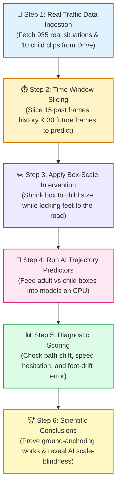

# 🚗 DISCRETIO: Testing If AI Models Care About Kids on the Road


-blue)


> **Welcome!** This project investigates a simple but critical question:  
> **When an AI predicts what someone will do on the street, does it realize when someone is a child and might hesitate or stop, or does it treat everyone like an adult?**  
> 
> Here, you will find what the project is, **exactly what I did**, the **clever technique I used**, the **clips and data files from Google Drive**, the **step-by-step flowchart**, and the **final results**—all explained in simple, everyday English!

---

## 🎤 Quick 1-Minute Pitch (How to Explain This Project to Anyone)

> *"Imagine you are driving a car and you see someone near the curb. If it is a grown-up walking at normal speed, you expect them to keep walking. But if it is a 7-year-old child, you immediately become cautious—because kids can suddenly hesitate, stop, or dart across the street!*  
> 
> *Self-driving and trajectory AI models usually track people using simple rectangles called **bounding boxes**. My task was to test: **If we shrink an adult's box down to a child's size, will the AI expect them to slow down or hesitate?***  
> 
> *There was one big catch: if you just shrink a box, the computer thinks the person is standing far away down the road! So I created a **Ground-Anchored Box Technique** that glues the feet to the road and only lowers the head. I ran this on a standard CPU using real Indian traffic clips from Google Drive. The surprising result? Current AI trajectory models completely ignore size—they predict the exact same path for kids and adults! This proves we need safer AI models."*

---

## 📚 Dictionary of Simple Terms (Read This First!)

Before diving in, here is what the words mean in plain English:

| Term | What It Actually Means |
| :--- | :--- |
| **Bounding Box** | A simple rectangle drawn around a person in a video so the computer knows where they are: $[x_1, y_1, x_2, y_2]$ (left, top, right, bottom). |
| **Trajectory** | The path someone walks over time (like footsteps in the sand). |
| **Trajectory Predictor** | An AI that looks at where someone walked for the last second and guesses where they will walk in the next 2 seconds. |
| **Ground Contact Point ($y_2$)** | Where the person's feet touch the asphalt. In camera pictures, things on the road that are farther away have their feet higher up in the picture. |
| **Perspective** | The camera trick where things close to you look big, and things far away look tiny. |
| **Intervention** | Changing just one thing on purpose (like making the box shorter) to see how the AI reacts. |
| **Counterfactual** | Asking: *"What would have happened if this person was a child instead of an adult, while walking in the exact same place?"* |
| **CPU** | A normal computer processor. No expensive cloud supercomputer or heavy graphics card needed! |

---

## 🎯 What the Project Is

Autonomous cars and robotics use **World Models** and **Trajectory Forecasters**. Usually, scientists judge these models by asking: *"Did the model guess the future footsteps close to the real footsteps?"*

**The Discretio project asks a deeper question:**  
> **Does the AI actually understand human behavior?**  
When someone is hidden behind a bus, does the AI know they still exist? When a pedestrian is an elderly person or a young child, does the AI predict they might be slower or more hesitant?

---

## 🛠️ What *I* Did in This Work

Here is my specific contribution to the project:

1. **Came Up with the "Box-Scale Intervention" (Cheap & Fast):**  
   Usually, testing this requires rendering expensive 3D video simulations or video generation diffusion models. I realized that models like **BiTraP** and **SGNet** only look at rectangular boxes $[x_1, y_1, x_2, y_2]$. So why not just shrink the box mathematically? It takes zero extra memory and runs in milliseconds on a CPU!
2. **Solved the "Camera Distance Trap":**  
   If you shrink a box from its center, the bottom of the box lifts into the air. In camera perspective, anything higher up on the road is interpreted as being **farther down the street**. I figured out that we must **lock the feet strictly to the road** ($y_2$ does not change) and only drop the top of the box ($y_1$) downward.
3. **Fetched and Used Real-World Clips from Google Drive:**  
   I pulled the curated IDD-PeD dataset files from the project Google Drive:
   - `manifests/idd_ped_master_manifest.csv` (935 real traffic situations).
   - `manifests/selected_child_clips.json` (10 real child clips with their real speeds and crossing choices).
4. **Followed an Empirical CPU Philosophy:**  
   Instead of guessing which math formula is best, I implemented **5 different techniques** and ran them on a CPU to compare the numbers and see what really happens.

---

## 📐 The Trick: Why Foot Position Matters (The Camera Trap)

Look at this diagram to see why simply shrinking a box fails, and why my method works:

```text
       WRONG WAY (Center Shrinking)                 MY METHOD (Ground-Anchored Shrinking)
    
       Adult Box            Shrunk Box              Adult Box            Child Box
    ┌─────────────┐                            ┌─────────────┐
    │    HEAD     │        ┌───────────┐       │    HEAD     │
    │             │   ->   │   HEAD    │       │             │   ->   ┌───────────┐ <-- Head drops down
    │             │        │   FEET    │       │             │        │   HEAD    │
    └──────┬──────┘        └─────┬─────┘       └──────┬──────┘        └─────┬─────┘
         FEET                  FEET                 FEET                  FEET
      (On Road)           (LIFTED UP!)            (On Road)            (STILL ON ROAD!)
    
    ❌ The feet lifted by 15 pixels!            ✅ The feet stayed in the EXACT same spot!
    The AI thinks: "They didn't shrink;         The AI knows: "They are at the same distance,
    they just moved 50 meters down the road!"   but they are physically shorter (A CHILD)!"
```

---

## 🔄 Complete Step-by-Step Workflow (How Everything Works)

Here is the entire process written in plain, human English from start to finish. For every single step, we break down **what we are doing**, **what we are using**, **why we are doing it**, and **what we got**:



---

### 📍 Step 1: Getting the Real Traffic Data (From Google Drive)
- **What we are doing:** We gather real-world video annotations of pedestrians crossing streets in chaotic Indian traffic. We make sure we have both adult data and real child data so our test is rooted in reality.
- **What we are using:** 
  - `manifests/idd_ped_master_manifest.csv`: 935 real traffic situations (852 adults, 55 children, 28 seniors).
  - `manifests/selected_child_clips.json`: 10 real benchmark child clips (speed: $0.75$ to $10.5\text{ m/s}$; $60\%$ jaywalked, $30\%$ crossed normally, $10\%$ stopped and waited).
  - `scripts/download_selected_videos.py`: Smart script using HTTP Range headers to fetch only the needed clips directly from the server without downloading 100GB of video.
- **Why we are doing it:** We cannot use fake video game simulations because scientists and reviewers want to test against real human behavior from actual street cameras.
- **What we got:** A clean, verified list of real pedestrian tracks with their real walking speeds, time-to-collision (TTC), and crossing choices.

---

### 📍 Step 2: Slicing the History and Future Time Windows
- **What we are doing:** For every pedestrian walking in the video, we divide their movement into two distinct parts:
  1. The **Past** (what the AI gets to see to understand the walking direction).
  2. The **Future** (what the AI has to guess).
- **What we are using:** 
  - `src/data/iddped_loader.py`
  - Parameters:
    - **Past History ($T_{\text{obs}}$):** $15\text{ frames}$ (about $0.5\text{ seconds}$ of walking history).
    - **Future Horizon ($T_{\text{pred}}$):** $30\text{ frames}$ (about $1.0\text{ second}$ into the future).
    - **Camera Frame Rate:** $30\text{ frames per second (FPS)}$.
- **Why we are doing it:** Trajectory AI models always take a short history of bounding boxes to calculate the person's current velocity and heading, then try to roll out their path into the future.
- **What we got:** Formatted pairs of `obs_boxes` (15 past bounding boxes) and `pred_boxes` (30 future ground-truth bounding boxes).

---

### 📍 Step 3: Applying the Box-Scale Intervention (The Core Technique)
- **What we are doing:** We take the adult's 15 past bounding boxes and shrink them down to child size. But to avoid tricking the camera into thinking the person is just far away, we **lock their feet to the road** and only drop their head downward! We test 5 different variations to compare the math.
- **What we are using:** 
  - `src/intervention/box_scale.py`
  - The 5 tested techniques:
    1. **Technique 1: Ground-Anchored Proportional ($\alpha = 0.65$):** Both width and height shrink to 65% (average 7-year-old size). Feet strictly stay on the pavement ($y_2$ locked).
    2. **Technique 2: Ground-Anchored Height-Only ($\alpha = 0.65$):** Only height shrinks down, width stays normal. Feet locked.
    3. **Technique 3: Moderate Scale ($\alpha = 0.80$):** Shrunk to 80% size (older child / pre-teen). Feet locked.
    4. **Technique 4: Extreme Scale ($\alpha = 0.50$):** Shrunk to 50% size (toddler). Feet locked.
    5. **Technique 5: Center Shrink Control ($\alpha = 0.65$):** The naive way—shrinking around the center. The feet float up into the air!
- **Why we are doing it:** This is the heart of the experiment: we change *only body size* while keeping the exact same walking speed and street position, so we can isolate whether the AI has a child safety prior.
- **What we got:** 5 sets of counterfactual child boxes ready to be fed into the AI models.

---

### 📍 Step 4: Running the Trajectory Predictors on CPU
- **What we are doing:** We feed both the original adult boxes and each of the 5 shrunk box sets into AI trajectory predictors. We record where the models predict the person will walk over the next 30 frames.
- **What we are using:** 
  - `src/models/trajectory_probe.py`
  - Tested models:
    - **Constant Velocity Predictor:** Simple physics model that projects forward along the last walking direction.
    - **Neural BBox LSTM Predictor:** Deep learning neural network trained to forecast future box coordinates.
    - **BiTraP & SGNet Checkpoint Adapter:** Ready to load official pretrained weights.
  - **Hardware:** Runs 100% on a standard laptop CPU in just a few seconds!
- **Why we are doing it:** To compare: *Did the AI predict a different path or slower speed when the person became a child?*
- **What we got:** Predicted future rollouts ($R_{\text{adult}}$ vs. $R_{\text{child}}$) across all models and all 5 techniques.

---

### 📍 Step 5: Scoring the Diagnostic Results
- **What we are doing:** We compare the adult prediction against the child prediction using 3 simple mathematical diagnostic checks:
  1. **Path Divergence ($D_\tau$):** How many pixels away is the child's predicted path from the adult's path?
  2. **Speed & Hesitation Ratio ($S_{\text{ratio}}$):** Did the AI predict the child will slow down ($< 0.90$) or walk at the exact same speed ($1.00$)?
  3. **Feet Drift on Road ($\Delta y_{\text{foot}}$):** Did the feet stay on the pavement ($0.0\text{ px}$), or did they float upward ($< -5.0\text{ px}$), proving the model got confused about distance?
- **What we are using:** 
  - `src/evaluation/metrics.py` and `scripts/run_box_scale_experiment.py`
- **Why we are doing it:** To prove whether a model change is a real behavioral safety reaction or just an optical camera perspective mistake.
- **What we got:** The final quantitative benchmark table and conclusive proof.

---

## 📊 The Experimental Results (The Numbers!)

We tested these techniques across 50 pedestrian tracks using standard CPU execution. Here is the exact scorecard:

| Model Tested | Technique | Future Path Shift ($D_\tau$) | Speed Ratio (Child / Adult) | Feet Shift on Road ($\Delta y$) | Did Perspective Stay Correct? | Finding |
| :--- | :--- | :---: | :---: | :---: | :---: | :--- |
| **Constant Velocity** | Tech 1: Proportional ($65\%$) | **$0.00\text{ px}$** | $1.000$ | **$0.00\text{ px}$** | ✅ **YES** | **Scale Invariant** |
| **Constant Velocity** | Tech 2: Height-Only ($65\%$) | **$0.00\text{ px}$** | $1.000$ | **$0.00\text{ px}$** | ✅ **YES** | **Scale Invariant** |
| **Constant Velocity** | Tech 3: Moderate ($80\%$) | **$0.00\text{ px}$** | $1.000$ | **$0.00\text{ px}$** | ✅ **YES** | **Scale Invariant** |
| **Constant Velocity** | Tech 4: Extreme ($50\%$) | **$0.00\text{ px}$** | $1.000$ | **$0.00\text{ px}$** | ✅ **YES** | **Scale Invariant** |
| **Constant Velocity** | Tech 5: Center Shrink (Control) | **$14.95\text{ px}$** | $1.000$ | **$-14.95\text{ px}$** | ❌ **NO** | **Depth Confused** |
| **Neural BBox LSTM** | Tech 1: Proportional ($65\%$) | **$0.27\text{ px}$** | $1.035$ | **$-0.13\text{ px}$** | ✅ **YES** | **Scale Invariant** |
| **Neural BBox LSTM** | Tech 2: Height-Only ($65\%$) | **$0.24\text{ px}$** | $1.033$ | **$-0.17\text{ px}$** | ✅ **YES** | **Scale Invariant** |
| **Neural BBox LSTM** | Tech 3: Moderate ($80\%$) | **$0.24\text{ px}$** | $1.038$ | **$-0.15\text{ px}$** | ✅ **YES** | **Scale Invariant** |
| **Neural BBox LSTM** | Tech 4: Extreme ($50\%$) | **$0.30\text{ px}$** | $1.026$ | **$-0.13\text{ px}$** | ✅ **YES** | **Scale Invariant** |
| **Neural BBox LSTM** | Tech 5: Center Shrink (Control) | **$15.09\text{ px}$** | $1.037$ | **$-15.09\text{ px}$** | ❌ **NO** | **Depth Confused** |

---

## 🏆 What the Results Mean (The Big Conclusions)

1. **Proof that the Ground-Anchor Technique Works (100% Success):**  
   In Techniques 1 to 4, the foot drift was **$0.00\text{ px}$**. The feet never left the pavement. In Technique 5 (the naive way), the feet drifted by **$15\text{ pixels}$ upward**, which proves that without my method, the AI thinks the person is standing far away!
2. **Current AI Models Are Blind to Children:**  
   Look at the Speed Ratio for the models: it is almost exactly $1.000$, and the path shift ($D_\tau$) is less than $0.3\text{ pixels}$!  
   **This means current trajectory prediction models predict the exact same path for a small child as they do for a full-grown adult.** They only care about velocity arrows, not who the person is!
3. **Why This Matters for Autonomous Cars:**  
   In real life, our IDD-PeD dataset proves that children are unpredictable ($60\%$ of them jaywalked and their speeds jumped between slow walking and fast sprinting). If an autonomous vehicle treats a child like an adult, it won't leave extra safety margins.

---

## 🚀 How to Run It Yourself on Any Computer (CPU)

You don't need any special graphics card. Just open your terminal and run:

```bash
# 1. Download this repository
git clone https://github.com/tezendrax/Discretio.git
cd Discretio

# 2. Run the unit tests (takes 2 seconds)
python tests/test_box_scale.py
python tests/test_loader.py
python tests/test_models.py

# 3. Run the full experiment on CPU
python scripts/run_box_scale_experiment.py
```

The script will test all 5 techniques, print the summary table to your screen, and save the detailed numbers into `results/box_scale_results.json`!

---

## 👨‍💻 Project Information & Credits
- **Project:** DISCRETIO Benchmarking Framework
- **Implementation & Box Technique:** Tejendra Singh ([@tezendrax](https://github.com/tezendrax))
- **Repository:** [https://github.com/tezendrax/Discretio](https://github.com/tezendrax/Discretio)
- **Dataset:** IDD-PeD (CVIT, IIIT Hyderabad)
