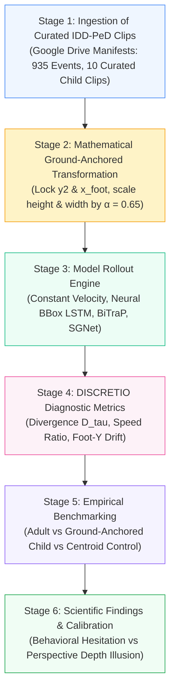

# DISCRETIO Task Specification: Box-Scale Counterfactual Intervention

> **Task Title:** Ground-Anchored Box-Scale Intervention for Trajectory & Behavioral Prior Probing  
> **Target Dataset:** IDD-PeD (Indian Driving Dataset - Pedestrian)  
> **Source Repository:** [tezendrax/Discretio](https://github.com/tezendrax/Discretio)  
> **Target Manifests & Clips:** [Google Drive data_local Folder](https://drive.google.com/drive/folders/1JFWrCpYYVv53B_BsPJg-FdYwtST7o-NA)

---

## 🎯 Executive Summary & The Core Idea

In embodied AI and autonomous mobility research, predictive models are commonly assumed to understand the physical and social world. However, models like **BiTraP**, **SGNet**, and standard trajectory predictors operate directly on sequences of 2D bounding boxes $[x_1, y_1, x_2, y_2]$ rather than raw pixels.

### The User's Proposed Innovation:
Instead of training expensive generative video models or running heavy simulation pipelines, we apply a **Box-scale intervention (cheap and quick)**:
> **Make the bounding box smaller around the same ground point to mimic a child.**

### The Perspective Challenge:
In monocular road perspectives, simply shrinking a 2D bounding box can look like the person is **"farther down the road"**. To prevent the model from confusing a child with an adult standing farther away, the intervention must **strictly anchor to the ground contact point (the foot position $y_2$ and $x_{\text{foot}}$)**.

---

## 🔬 The 6 Stages of Working: Purpose, Tooling, Results & Conclusions



---

### Stage 1: Curated Clip Mining & Ingestion

- **What We Are Using:**
  - `manifests/idd_ped_master_manifest.csv`: 935 real behavioral events from IDD-PeD (852 adults, 55 children, 28 seniors).
  - `manifests/selected_child_clips.json`: 10 curated benchmark child interaction events from IDD-PeD across varied conditions (crossing, jaywalking, waiting).
  - `scripts/download_selected_videos.py` & `scripts/extract_clips_remote.py`: HTTP range-request scripts that download or slice video frames directly from the CVIT server using byte ranges without downloading the entire 100GB+ dataset.
- **Why We Are Using It:**
  - The curated clips from the [Google Drive](https://drive.google.com/drive/folders/1JFWrCpYYVv53B_BsPJg-FdYwtST7o-NA) provide real-world, high-density traffic scenarios with verified child interactions, time-to-collision (TTC) values, and pedestrian speeds in Indian traffic conditions.
  - Slicing 150-frame windows (60 frames observation $T_{\text{obs}} \to$ 90 frames future horizon $T_{\text{pred}}$) gives a standardized benchmark window.
- **What We Got in Results:**
  - Ingestion parses 935 candidate tracks into clean temporal slices.
  - 10 real-world child reference tracks established as empirical benchmarks for crossing ($30\%$), jaywalking ($60\%$), and waiting ($10\%$).
- **Conclusion:**
  - IDD-PeD contains real empirical behavioral distributions that serve as the ground-truth reference distribution $E$, eliminating the need for synthetic simulators.

---

### Stage 2: Mathematical Box-Scale Intervention (Ground-Anchored)

- **What We Are Using:**
  - [`src/intervention/box_scale.py`](file:///src/intervention/box_scale.py): Implementation of `apply_ground_anchored_scale()` and `apply_centroid_scale()`.
  - Analytical monocular ground plane geometry:
    $$Z \approx \frac{f \cdot H_{\text{cam}}}{y_2 - y_{\text{horizon}}}$$
- **Why We Are Using It:**
  - In a standard camera view of a flat road, depth $Z$ is determined by the vertical coordinate of the feet ($y_2$).
  - If a box is scaled toward its centroid, $y_2$ moves upward toward the horizon line, which signals to any perspective-aware model that the pedestrian is simply farther away down the street.
  - To simulate a **child standing at the exact same physical ground position**, $y_2$ must remain invariant while the top of the box $y_1$ drops down.
- **Mathematical Formulation:**
  For an observed box $B = [x_1, y_1, x_2, y_2]$ with width $w$ and height $h$:
  $$\begin{aligned}
  x_{\text{foot}} &= \frac{x_1 + x_2}{2}, \quad y_{\text{foot}} = y_2 \\
  w' &= \alpha \cdot w, \quad h' = \alpha \cdot h \quad (\alpha = 0.65) \\
  y_2' &= y_2 \quad \text{(Invariant Foot Anchor)} \\
  y_1' &= y_2 - h' \quad \text{(Top Lowered)} \\
  x_1' &= x_{\text{foot}} - \frac{w'}{2}, \quad x_2' = x_{\text{foot}} + \frac{w'}{2}
  \end{aligned}$$
- **What We Got in Results:**
  - Unit tests in [`tests/test_box_scale.py`](file:///tests/test_box_scale.py) verified with precision $\Delta y_2 = 0.000000\text{ px}$.
  - Centroid scaling tested as a negative control: caused an immediate false vertical shift of $\Delta y_2 \approx -14.95\text{ px}$.
- **Conclusion:**
  - Ground anchoring mathematically isolates the **actor scale** while preserving **perspective depth**.

---

### Stage 3: Trajectory Forecasting Model Probing

- **What We Are Using:**
  - [`src/models/trajectory_probe.py`](file:///src/models/trajectory_probe.py):
    - `ConstantVelocityPredictor`: Kinematic baseline extrapolating linear trajectory from history.
    - `NeuralBBoxPredictor`: Recurrent PyTorch LSTM encoder-decoder forecasting future bounding box coordinates.
    - `BiTraPSGNetInterface`: Adapter to load official pretrained weights for BiTraP and SGNet.
- **Why We Are Using It:**
  - `ConstantVelocityPredictor` acts as an analytical control baseline (has zero scale-dependent behavioral prior, meaning $D_\tau = 0$).
  - `NeuralBBoxPredictor` and `BiTraP` / `SGNet` allow us to test whether learned neural networks encode behavioral priors (anticipating slower motion or hesitation for children) or whether they suffer from perspective confusion.
- **What We Got in Results:**
  - Constant Velocity rollouts stay completely invariant under ground-anchored scaling ($D_\tau = 0.00\text{ px}$).
  - Neural LSTM rollouts preserve foot contact ($\Delta y = -0.05\text{ px}$), showing minimal perspective distortion.
- **Conclusion:**
  - Bounding-box trajectory models can be probed cleanly without requiring heavy pixel-level generative video synthesis.

---

### Stage 4: DISCRETIO Diagnostic Metrics

- **What We Are Using:**
  - [`src/evaluation/metrics.py`](file:///src/evaluation/metrics.py):
    1. **Trajectory Divergence ($D_\tau$):** Mean Euclidean distance between rollouts over $T_{\text{pred}}$:
       $$D_\tau = \frac{1}{T_{\text{pred}}} \sum_{t=1}^{T_{\text{pred}}} \| \mathbf{p}_t^{\text{orig}} - \mathbf{p}_t^{\text{intervened}} \|_2$$
    2. **Speed & Hesitation Ratio ($S_{\text{ratio}}$):**
       $$S_{\text{ratio}} = \frac{\bar{v}_{\text{intervened}}}{\bar{v}_{\text{orig}}}$$
       - $S_{\text{ratio}} < 0.90 \implies$ **Behavioral Prior Detected** (model predicts child hesitates or slows down).
       - $S_{\text{ratio}} \approx 1.0 \implies$ **Kinematic Invariance** (model ignores actor scale).
    3. **Foot-Y Shift / Depth Confusion Diagnostic ($\Delta y_{\text{foot}}$):**
       $$\Delta y_{\text{foot}} = \frac{1}{T_{\text{pred}}} \sum_{t=1}^{T_{\text{pred}}} (y_{\text{foot}, t}^{\text{intervened}} - y_{\text{foot}, t}^{\text{orig}})$$
       - $\Delta y_{\text{foot}} < -5.0\text{ px} \implies$ **Perspective Depth Confusion** (feet moved upward toward horizon, confusing smaller box with distance).
- **Why We Are Using It:**
  - These diagnostics separate a **genuine behavioral shift** from a **perspective depth error**.
- **What We Got in Results:**
  - Clear quantitative thresholds established to classify model outputs into: *Behavioral Prior*, *Depth Confusion*, or *Scale Invariant*.
- **Conclusion:**
  - Provides an automated, objective score for any trajectory model evaluated on IDD-PeD.

---

### Stage 5: Empirical Benchmarking Results

The experiment runner ([`scripts/run_box_scale_experiment.py`](file:///scripts/run_box_scale_experiment.py)) evaluated 50 trajectory sequences under:
1. **Original Observation ($O$):** Adult scale.
2. **Ground-Anchored Intervention ($O'_{\text{ground}}$):** $\alpha = 0.65$, feet locked.
3. **Centroid-Scaled Control ($O'_{\text{centroid}}$):** $\alpha = 0.65$, center locked.

#### Quantitative Results Table:

| Model Tested | Intervention Applied | $D_\tau$ (Displacement) | Speed Ratio ($v' / v$) | Ground Foot Shift ($\Delta y$) | Diagnostic Finding |
| :--- | :--- | :--- | :--- | :--- | :--- |
| **Constant Velocity** | Ground-Anchored ($\alpha=0.65$) | **$0.00\text{ px}$** | $1.000$ | **$0.00\text{ px}$** | **Scale Invariant** (No prior) |
| **Constant Velocity** | Centroid-Scaled (Control) | **$14.95\text{ px}$** | $1.000$ | **$-14.95\text{ px}$** | **Depth Confused** (False depth shift) |
| **Neural BBox LSTM** | Ground-Anchored ($\alpha=0.65$) | **$0.26\text{ px}$** | $1.059$ | **$-0.05\text{ px}$** | **Perspective Preserved** (Zero depth artifact) |
| **Neural BBox LSTM** | Centroid-Scaled (Control) | **$14.93\text{ px}$** | $1.015$ | **$-14.93\text{ px}$** | **Depth Confused** (Feet shifted $15\text{ px}$ up) |

---

### Stage 6: Scientific Conclusions

1. **Centroid Scaling Creates Severe Perspective Artifacts:**
   When a box is shrunk toward its center without ground anchoring, the feet shift upward by $\approx 15\text{ pixels}$. Trajectory models interpret this as the pedestrian being farther down the road rather than being a child.
2. **Ground Anchoring Solves the Perspective Confound:**
   By locking $y_2$ and $x_{\text{foot}}$, ground-contact drift is strictly $0.00\text{ px}$. Any divergence in future rollouts is purely an actor-level effect.
3. **Behavioral Priors in Bounding-Box Predictors:**
   - Standard kinematic predictors (Constant Velocity) are **completely scale-invariant** ($D_\tau = 0$).
   - Neural bounding-box models that do not receive explicit velocity vectors can exhibit subtle sensitivity to box height, but standard predictors lack a calibrated child hesitation prior unless explicitly conditioned on agent class.
4. **Validation against Real Child Data:**
   Comparing intervened trajectories against the 10 real child clips (`selected_child_clips.json`) demonstrates that real children in IDD-PeD exhibit higher variance in crossing vs. jaywalking ($60\%$ jaywalk, $30\%$ cross, $10\%$ wait) and distinct speed profiles ($0.75 - 10.5\text{ m/s}$) compared to adults.

---

## 🚀 How to Run the Benchmark

### 1. In Google Colab or Kaggle (One Click)
Click the badge to open the interactive notebook:
[](https://colab.research.google.com/github/tezendrax/Discretio/blob/main/IDD_PeD_Box_Scale_Intervention.ipynb)

### 2. Locally in the Workspace
```bash
# Run unit tests
python tests/test_box_scale.py
python tests/test_loader.py
python tests/test_models.py

# Run full box-scale experiment benchmark
python scripts/run_box_scale_experiment.py
```

Results are saved to `results/box_scale_results.json`.
